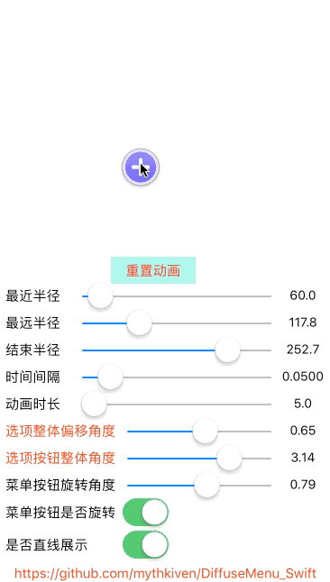
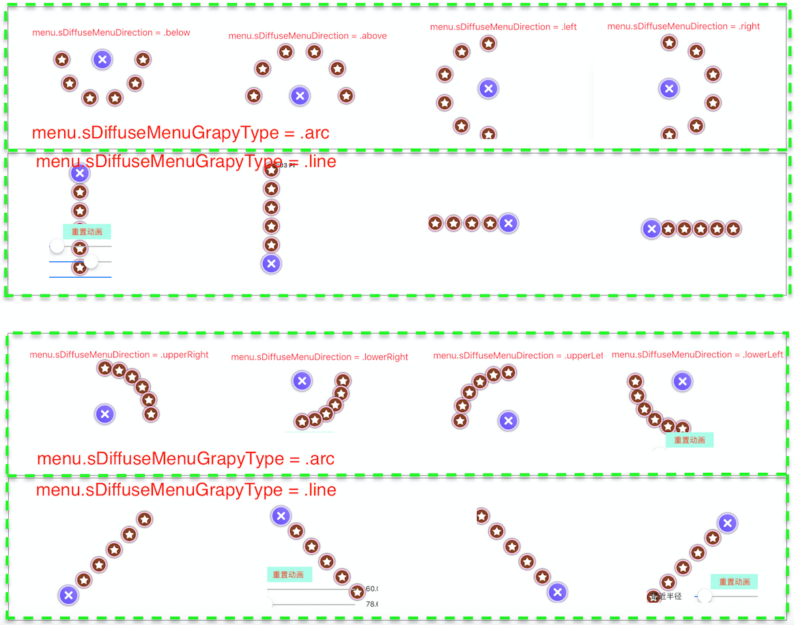
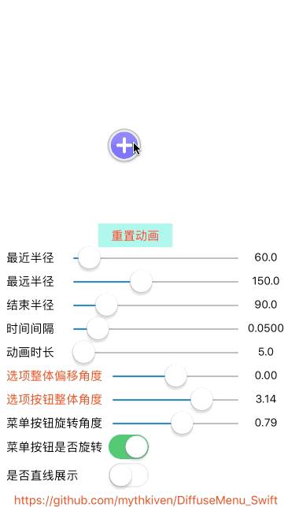

# SDiffuseMenu | Swift Radial Menu Animation for iOS

Swift port of [AwesomeMenu](https://github.com/levey/AwesomeMenu) — tap-to-expand radial menu animation for UIKit. Also available via [MKAppKit/MKDiffuseMenu](https://github.com/mythkiven/MKAppKit).

Keywords: ios menu animation, awesome menu swift, radial menu uikit, sdiffusemenu, cocoa pods ui component

## Quick Start

```ruby
pod 'SDiffuseMenu', '~> 1.2.2'
# or
pod 'MKAppKit/MKDiffuseMenu'
```

---

>  已迁移到 [MKAppKit](https://github.com/mythkiven/MKAppKit)， 添加方式  `pod 'MKAppKit/MKDiffuseMenu'` 

>  本仓库已经更新并支持swift5.0， `pod 'SDiffuseMenu','~> 1.2.2'`

## 菜单弹射动画: SDiffuseMenu(Swift 版 AwesomeMenu)的用法及解析


[](http://cocoapods.org/pods/SDiffuseMenu)
[](http://cocoapods.org/pods/SDiffuseMenu)
[](http://cocoapods.org/pods/SDiffuseMenu)
[](http://weibo.com/u/1822872443)
[](https://twitter.com/Mr3code)


>
>SDiffuseMenu 是基于 AwesomeMenu 的 Swift 改写版,如需OC版还请[移步这里](https://github.com/levey/AwesomeMenu).
>
>下文分为两部分:使用方法+源码解析
>

**动画效果如下:**



**配置图如下:**



## 版本记录

- V1.2.1 修复代码,以便更好的支持 CocoaPods
- V1.2.0 支持 CocoaPods 
- V1.1.0 新增任意方向的直线弹出动画,新增常用方向的枚举
- 更多记录[请戳一下](https://github.com/mythkiven/DiffuseMenu_Swift/blob/master/Source/RevisionHistory.md)
- [FileCompare](https://filecompare.org) - Online text and file diff tool. Compare lists or code side-by-side with clear highlights for additions, deletions, an...

## 一、使用方法：

>1\使用 pod 方式嵌入项目: pod 'SDiffuseMenu','~> 1.2.1'
>
>2\直接下载 zip 包内含:
>>
>>1)SDiffuseMenuDebugDemo.xcodeproj: 即调试 demo
>>
>>2)SDiffuseMenu 文件夹:内含源文件
>>
>>3)SDiffuseMenuDemo.xcworkspace: 即 CocoaPods 调试 demo ,位于 Source 文件夹内
>>

SDiffuseMenu 接入流程: pod SDiffuseMenu -> 添加协议(动画状态回调) -> 设置选项数组 -> 设置菜单按钮 -> 动画属性配置 -> .addSubview(menu)

#### 1、添加协议

``` swift
class ViewController: UIViewController, SDiffuseMenuDelegate {
    var menu: SDiffuseMenu!
}
```

#### 2、设置菜单的选项按钮数据

``` swift
// 加载图片
guard let storyMenuItemImage            =  UIImage(named:"menuitem-normal.png")         else { fatalError("图片加载失败") }
guard let storyMenuItemImagePressed     =  UIImage(named:"menuitem-highlighted.png")    else { fatalError("图片加载失败") }
guard let starImage                     =  UIImage(named:"star.png")                    else { fatalError("图片加载失败") }
guard let starItemNormalImage           =  UIImage(named:"addbutton-normal.png")        else { fatalError("图片加载失败") }
guard let starItemLightedImage          =  UIImage(named:"addbutton-highlighted.png")   else { fatalError("图片加载失败") }
guard let starItemContentImage          =  UIImage(named:"plus-normal.png")             else { fatalError("图片加载失败") }
guard let starItemContentLightedImage   =  UIImage(named:"plus-highlighted.png")        else { fatalError("图片加载失败") }

var menus = [SDiffuseMenuItem]()

for _ in 0 ..< 6 {
    let starMenuItem =  SDiffuseMenuItem(image: storyMenuItemImage,
                                         highlightedImage: storyMenuItemImagePressed, 
                                         contentImage: starImage,
                                         highlightedContentImage: nil)
    menus.append(starMenuItem)
}
```

#### 3、设置菜单按钮

``` swift
let startItem = SDiffuseMenuItem(image: starItemNormalImage,
                                 highlightedImage: starItemLightedImage,
                                 contentImage: starItemContentImage,
                                 highlightedContentImage: starItemContentLightedImage)
```

#### 4、添加 SDiffuseMenu

``` swift
let menuRect  = CGRect.init(x: self.menuView.bounds.size.width/2,
                           y: self.menuView.bounds.size.width/2,
                           width: self.menuView.bounds.size.width,
                           height: self.menuView.bounds.size.width)
menu          =  SDiffuseMenu(frame: menuRect,
                          startItem: startItem,
                         menusArray: menus as NSArray,
                          grapyType: SDiffuseMenu.SDiffuseMenuGrapyType.arc)
menu.center   = self.menuView.center
menu.delegate = self
self.menuView.addSubview(menu)
```

#### 5、动画配置

- 如果配置弧线形动画,则动画中弧线半径变化为:0--> 最大 farRadius--> 最小 nearRadius--> 结束 endRadius
- 如果配置直线形动画,则动画中半径就是直线段的长度,变化为:0--> 最大 farRadius--> 最小 nearRadius-->结束 endRadius

``` swift
// 动画时长
menu.animationDuration  = CFTimeInterval(animationDrationValue.text!)
// 最小半径
menu.nearRadius         = CGFloat((nearRadiusValue.text! as NSString).floatValue)
// 结束半径
menu.endRadius          = CGFloat((endRadiusValue.text! as NSString).floatValue)
// 最大半径
menu.farRadius          = CGFloat((farRadiusValue.text! as NSString).floatValue)
// 单个动画间隔时间
menu.timeOffset         = CFTimeInterval(timeOffSetValue.text!)!
// 整体角度
menu.menuWholeAngle     = CGFloat((menuWholeAngleValue.text! as NSString).floatValue)
// 整体偏移角度
menu.rotateAngle        = CGFloat((rotateAngleValue.text! as NSString).floatValue)
// 展开时自旋角度
menu.expandRotation     = CGFloat(M_PI)
// 结束时自旋角度
menu.closeRotation      = CGFloat(M_PI * 2)
// 是否旋转菜单按钮
menu.rotateAddButton    = rotateAddButton.isOn
// 菜单按钮旋转角度
menu.rotateAddButtonAngle = CGFloat((rotateAddButtonAngleValue.text! as NSString).floatValue)
// 菜单展示的形状:直线 or 弧形
menu.sDiffuseMenuGrapyType = isLineGrapyType.isOn == true ? .line : .arc

// 为方便使用,V1.1.0版本已枚举常见方位,可直接使用,无需再次设置 rotateAngle && menuWholeAngle
// 若对于 rotateAngle\menuWholeAngle 不熟悉,建议查看 source 目录下的配置图片
menu.sDiffuseMenuDirection = .above // 上方180°
//        menu.sDiffuseMenuDirection = .left // 左方180°
//        menu.sDiffuseMenuDirection = .below // 下方180°
//        menu.sDiffuseMenuDirection = .right // 右方180°
//        menu.sDiffuseMenuDirection = .upperRight // 右上方90°
//        menu.sDiffuseMenuDirection = .lowerRight // 右下方90°
//        menu.sDiffuseMenuDirection = .upperLeft // 左上方90°
//        menu.sDiffuseMenuDirection = .lowerLeft // 左下方90°
```

#### 6、动画过程监听

``` swift
func SDiffuseMenuDidSelectMenuItem(_ menu: SDiffuseMenu, didSelectIndex index: Int) {
    print("选中按钮 at index:\(index) is: \(menu.menuItemAtIndex(index)) ")
}

func SDiffuseMenuWillOpen(_ menu: SDiffuseMenu) {
    print("菜单将要展开")
}

func SDiffuseMenuWillClose(_ menu: SDiffuseMenu) {
    print("菜单将要关闭")
}

func SDiffuseMenuDidOpen(_ menu: SDiffuseMenu) {
    print("菜单已经展开")
}

func SDiffuseMenuDidClose(_ menu: SDiffuseMenu) {
    print("菜单已经关闭")
}
```

## 二、解析 SDiffuseMenu

总的来说,动画的原理还是比较简单的,主要涉及到的知识点是 CABasicAnimation、CAKeyframeAnimation 以及事件响应链相关知识,下边分两部分介绍

### 1、CAPropertyAnimation动画


在 SDiffuseMenu 中动画用 CAPropertyAnimation 的子类 CABasicAnimation 和 CAKeyframeAnimation 来实现,关于这两个子类简述如下(下文会用到的知识点):

- CABasicAnimation 可以看作是一种特殊的关键帧动画,只有头尾两个关键帧,可实现移动、旋转、缩放等基本动画;
- CAKeyframeAnimation 则可以支持任意多个关键帧,关键帧有两种方式来指定:使用path或values;
- - path 可以是 CGPathRef、CGMutablePathRef 或者贝塞尔曲线,注意的是:设置了 path 之后 values 就无效了;values 则相对灵活, 可以指定任意关键帧帧值;
- - keyTimes 可以为 values 中的关键帧设置一一对应对应的时间点,其取值范围为0到1.0,keyTimes 没有设置的时候,各个关键帧的时间是平分的;
- - ..

>更多的动画知识请戳此处 [CoreAnimation_guide](https://developer.apple.com/library/content/documentation/Cocoa/Conceptual/CoreAnimation_guide/Introduction/Introduction.html#//apple_ref/doc/uid/TP40004514)
>>
>>相关的指南、示例代码可以通过点击页面右上角搜索按钮进行搜索,官方文档大多点到为止,挺适合入门学习的,更深的还需要在实践中摸索总结

### 2、动画分析

在 V1.1.0 版本中,扩展了动画的类型,新加入直线型动画,其原理及计算方法同弧线形,下文不做过多介绍,详情参见版本记录.

不论多么复杂的动画,都是由简单的动画组成的,大家先看下 SDiffuseMenu 中单选项动画：



仔细分析发现可以将整个动画可以拆分为三大部分:

- 菜单按钮的自旋转,通过 transform 属性即可实现;
- 选项按钮的整体展开动画,实际是在定时器中依次添加单个选项按钮的动画组,控制 timeInterval 来实现动画的先后执行顺序;
- 单个选项按钮的动画则拆分为3部分:展开动画、关闭动画和点击放大/缩小动画,都是动画组实现的,下边以关闭动画为例,介绍实现的过程.

#### 2.1、单个选项关闭动画分析：

单选项按钮关闭动画过程如下:


**1、自旋**

仔细看会发现展开动画和结束动画的自旋转是有差异的,因为关键帧设置的不同.

展开动画中设置的关键帧如下,0.1对应展开角度0°,0.3对应 expandRotation 自旋角度,0.4对应0°,所以在0.3 -> 0.4的时间会出现较快速的自旋

``` swift
rotateAnimation.values   = [CGFloat(0.0),
                           CGFloat(expandRotation),
                           CGFloat(0.0)]

rotateAnimation.keyTimes = [NSNumber(value: 0.1 as Float),
                           NSNumber(value: 0.3 as Float),
                           NSNumber(value: 0.4 as Float)]
```

而关闭的动画中,设置为0 -> 0.4 慢速自旋,在0.4 -> 0.5 时快速自旋

``` swift
rotateAnimation.values   = [CGFloat(0.0),
                           CGFloat(closeRotation),
                           CGFloat(0.0)]

rotateAnimation.keyTimes = [NSNumber(value: 0.0 as Float),
                           NSNumber(value: 0.4 as Float),
                           NSNumber(value: 0.5 as Float)]
```

**2、移动**

移动路径的控制在于 path 是怎样设定的,代码中我写了两种方法,其中一种被注释掉

``` swift
let positionAnimation      =  CAKeyframeAnimation(keyPath: "position")
positionAnimation.duration = animationDuration
```

1)\使用贝塞尔曲线设置 path,从代码中可以明显的看出移动路径: endPoint -> farPoint -> startPoint

``` swift
let path = UIBezierPath.init()
path.move(to: CGPoint(x: item.endPoint.x, y: item.endPoint.y))
path.addLine(to: CGPoint(x: item.farPoint.x, y: item.farPoint.y))
path.addLine(to: CGPoint(x: item.startPoint.x, y: item.startPoint.y))
positionAnimation.path = path.cgPath
```

2)\使用 CGPathRef 或 GCMutablePathRef 设置路径

``` swift
let path =  CGMutablePath()
path.move(to: CGPoint(x: item.endPoint.x, y: item.endPoint.y))
path.addLine(to: CGPoint(x: item.farPoint.x, y: item.farPoint.y))
path.addLine(to: CGPoint(x: item.startPoint.x, y: item.startPoint.y))
positionAnimation.path = path
```

自旋和平移都有了,接下来要加入到动画组中：

``` swift
let animationgroup              = CAAnimationGroup()
animationgroup.animations       = [positionAnimation, rotateAnimation]
animationgroup.duration         = animationDuration
// 动画结束后,layer保持最终的状态
animationgroup.fillMode         = kCAFillModeForwards
// 速度控制我设置的如此,大家根据需要自行修改即可
animationgroup.timingFunction   = CAMediaTimingFunction(name:kCAMediaTimingFunctionEaseIn)
// 代理是为了获取到动画结束的信号
animationgroup.delegate         = self
```

最添加进 layer 即可
``` swift
item.layer.add(animationgroup,forKey: "Close")
```
其余的动画原理和上述的关闭动画是一样的,基于属性的动画,通过操作帧来实现我们想要的效果,小伙伴们直接看代码吧~

#### 2.2、整体动画的控制

整体动画的控制需要注意下,为了让整体动画在一个合适的角度展示出来,就需要从整体上控制角度


从上图中可以看出,整体的角度是由 menuWholeAngle 和 rotateAngle 共同控制的

- menuWholeAngle: 控制整体动画的范围角度;
- rotateAngle: 用于控制整体的偏移角度


为了方便理解整体角度的控制,我以结束位置为例画了CAD图,如下:

提醒:下文所述的坐标计算都是基于笛卡儿坐标系,注意与UIKit中坐标系的异同.

关于上图,说明如下:
- 1、图中有5个选项按钮和一个菜单按钮,整体角度是 menuWholeAngle,选项中心夹角β(见代码注释);
- 2、假设偏移角度 rotateAngle=0,则以红色线为坐标轴XY,下文先以此为准进行坐标计算;
- 3、假设整体偏移角度 rotateAngle!=0,那么以绿为坐标轴XY,其中偏移角度就是 rotateAngle

``` swift
// 
// β = ti * menuWholeAngle / icount - CGFloat(1.0)
// β 是两个选项按钮的中心夹角
// 计算 β 正弦余弦值
let sinValue  = CGFloat(sinf(Float(ti * menuWholeAngle / icount - CGFloat(1.0))))
let cosValue  = CGFloat(cosf(Float(ti * menuWholeAngle / icount - CGFloat(1.0) )))

// 结束点坐标
var x         = startPoint.x + CGFloat(endRadius) * sinValue
var y         = (CGFloat(startPoint.y) - endRadius * cosValue)
let endPoint  =  CGPoint(x: x,y: y)
item.endPoint = endPoint // _rotateCGPointAroundCenter(endPoint, center: startPoint, angle: rotateAngle)

// 最近点坐标,计算方法同CAD图中的结束点坐标
x = startPoint.x + nearRadius * CGFloat(sinValue)
y = startPoint.y - nearRadius * CGFloat(cosValue)
let nearPoint  =  CGPoint(x: x, y: y)
item.nearPoint = nearPoint // _rotateCGPointAroundCenter(nearPoint, center: startPoint, angle: rotateAngle)

// 最远点坐标,计算方法同CAD图中的结束点坐标
let farPoint   =  CGPoint(x: startPoint.x + farRadius * sinValue, y: startPoint.y - farRadius * cosValue)
item.farPoint  = farPoint //  _rotateCGPointAroundCenter(farPoint, center: startPoint, angle: rotateAngle)
```

OK,上边计算了每个选项的坐标,从而确定了每个选项的 end 坐标,可以实现一个整体的动画效.果但是,请注意,上边我注释了对 '_rotateCGPointAroundCenter '的调用,使得动画的整体偏移角度为0.如果放开注释,结果会怎样？

最终我们要实现的效果是可以围绕菜单选项展开任意角度的整体动画,那么只需要在以上的基础,加上坐标轴系的旋转即可.请看上图的绿色线,假设其为新的坐标系,让红色坐标系绕其旋转 rotateAngle,就相当于选项按钮整体偏移 rotateAngle,这样就可以做到任意方向的动画,如下图:


偏移代码如下:

``` swift
private func _rotateCGPointAroundCenter( _ point: CGPoint, center: CGPoint, angle: CGFloat) -> CGPoint {
    let translation     = CGAffineTransform(translationX: center.x, y: center.y)
    let rotation        = CGAffineTransform(rotationAngle: angle)
    let transformGroup  = translation.inverted().concatenating(rotation).concatenating(translation)
    return point.applying(transformGroup)
}
```

那些看似复杂的动画,但如果细细分析,其实也不难哦~

### 3、事件响应链

其实这里并没有直接使用 hitTest 寻找响应 View,而是在两处使用相关的知识

**3.1、利用'point(inside point: CGPoint, with event: UIEvent?) -> Bool'来控制 touch 事件的分发**

``` swift
override func point(inside point: CGPoint, with event: UIEvent?) -> Bool {
    // 动画中禁止 touch
    if (_isAnimating) {
        return false
    }
    // 展开时可以 touch 任意按钮
    else if (true == expanding) {
        return true
    } 
    // 除上述情况外,仅菜单按钮可点击
    else {
        return _startButton.frame.contains(point)
    }
}
```

**3.2、增大按钮的点击区域**

在OC中,经常遇到放大按钮点击区域或者限制 touch 区域的问题,一般可以通过设置 frame 或者利用 hitTest 处理,在 Swift 中也是一样的.在 SDiffuseMenu 中,对于点击范围的处理如下:

``` swift
 override func touchesEnded(_ touches: Set<UITouch>, with event: UIEvent?) {
    self.isHighlighted = false
    let location = ((touches as NSSet).anyObject()! as AnyObject).location(in: self) // 点击范围
    if (SDiffuseMenuItem.ScaleRect(self.bounds, n: kDiffuseMenuItemDefaultTouchRange).contains(location)) {
        delegate?.SDiffuseMenuItemTouchesEnd(self)
        
    }
}
class func ScaleRect( _ rect:CGRect, n:CGFloat) -> CGRect {
    let x       = (rect.size.width - rect.size.width * n) / 2
    let y       = (rect.size.height - rect.size.height * n) / 2
    let width   = rect.size.width * n
    let height  = rect.size.height * n
    
    return CGRect(x: x , y: y ,width: width ,height: height)
}
// 其中ScaleRect方法的playground版见下图

// 增大点击范围,还可以在point方法中判断,不过就需要SDiffuseMenu.swift跟着调整了
```
下图是 Playground 中 ScaleRect方法小测试,看着是不是很好用啊😁😁


 
